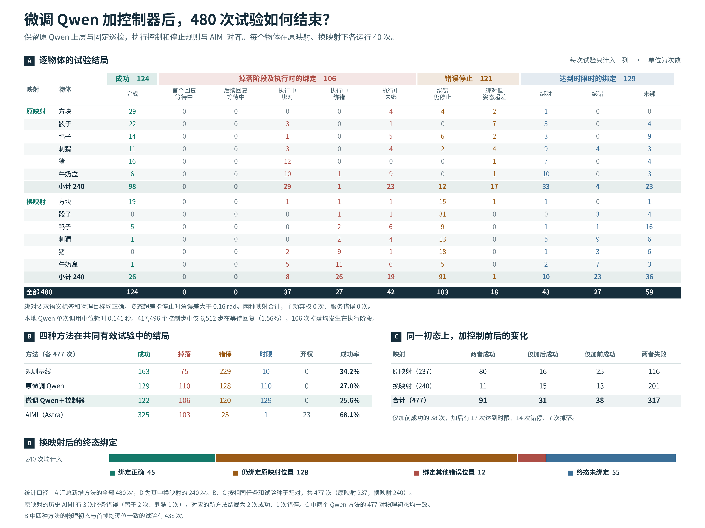

# Q1 补充实验结果

**Q1 · 给微调 VLM 加控制器，六物体成功率有提升吗？** 在 477 个共同有效的任务上，原微调 Qwen 成功 129 次（27.0%），加控制后成功 122 次（25.6%）。12 个物体与映射组合中，校正后的配对检验均未检出提升。

## Q1　六物体的微调 VLM 加控制器

**实验设置。** 六个物体各用原映射与换映射，每个组合 40 次。新增组保留对应物体的微调 Qwen 权重、RGB 与指令输入、768 维连续运动目标、固定巡检和最多 6 次调用。沿用该物体完整系统的运动与位姿配置、等待与执行控制器，以及自主停止规则。成功要求自主停止时仍持物、绑定正确目标、真实姿态角误差不超过 0.16 rad。三个原方法来自相同任务与种子的历史记录。[冻结方案](q1/analysis_protocol.json) · [历史对照与任务索引](q1/q1_historical_reference.json)

**逐物体成功次数。** 每行四种方法共用同一分母。原映射的历史 Astra 在 Duck 有 2 次服务错误、在 Hedgehog 有 1 次。四组共同剔除对应的三个槽。两种 Qwen 在全部 477 对上的物理初态哈希相同，四种方法同时满足物理初态与首帧哈希相同的有 438 对。[逐次结果与 24 项配对检验](q1/final_comparison.json) · [配对核验](q1/completion_verification.json)

| 物体 | 映射 | 共同样本 | Rule | 原微调 Qwen | Qwen 加控制器 | 完整系统（Astra） |
|---|---|---:|---:|---:|---:|---:|
| Cube | 原 | 40 | 23 | 30 | 29 | 32 |
| Cube | 换 | 40 | 23 | 16 | 19 | 32 |
| Die | 原 | 40 | 13 | 23 | 22 | 28 |
| Die | 换 | 40 | 1 | 0 | 0 | 26 |
| Duck | 原 | 38 | 15 | 14 | 13 | 25 |
| Duck | 换 | 40 | 9 | 2 | 5 | 24 |
| Hedgehog | 原 | 39 | 17 | 13 | 10 | 28 |
| Hedgehog | 换 | 40 | 10 | 2 | 1 | 32 |
| Pig | 原 | 40 | 21 | 16 | 16 | 37 |
| Pig | 换 | 40 | 15 | 3 | 0 | 33 |
| Milk carton | 原 | 40 | 13 | 9 | 6 | 17 |
| Milk carton | 换 | 40 | 3 | 1 | 1 | 11 |

| 六物体等权平均成功率 | Rule | 原微调 Qwen | Qwen 加控制器 | 完整系统（Astra） |
|---|---:|---:|---:|---:|
| 原映射 | 43.0% | 44.2% | 40.4% | 70.4% |
| 换映射 | 25.4% | 10.0% | 10.8% | 65.8% |

**同一任务上发生了什么变化？** 91 对两种 Qwen 均成功，31 对仅加控制后成功，38 对仅加控制前成功，317 对均失败。合并 477 对的描述性双侧精确 McNemar 检验为 *p* = 0.4704。预定分析在每个物体与映射内分别比较新增组与原 Qwen、与 Astra，并对 24 项检验联合做 Holm 校正。其中新增组与原 Qwen 的 12 项校正后 *p* 均为 1.000。[逐组合配对表](q1/final_comparison.json)

| 477 个共同有效任务的终态 | 成功 | 掉落 | 错停 | 达到时限 | 弃权 |
|---|---:|---:|---:|---:|---:|
| Rule | 163 | 75 | 229 | 10 | 0 |
| 原微调 Qwen | 129 | 110 | 128 | 110 | 0 |
| Qwen 加控制器 | 122 | 106 | 120 | 129 | 0 |
| 完整系统（Astra） | 325 | 103 | 25 | 1 | 23 |

单看新增组的全部 480 次，得到 124 次成功、106 次掉落、121 次错停、129 次达到时限，服务错误为 0。换映射的 240 次中，终态正确绑定 45 次，仍绑定到原映射位置 128 次，绑定到其他错误位置 12 次，未绑定 55 次。该条件的 92 次错停中有 91 次停在错误绑定上。下图进一步按物体、映射、掉落阶段和终态绑定拆开计数。[失败与绑定明细](q1/qwen_control_failure_breakdown.json) · [矢量大图 PDF](q1/figures/qwen_control_all_outcomes.pdf)



**等待控制有多少介入机会？** 新增组在六物体上共发出 1,939 次调用，单次响应中位数为 0.141 秒。417,496 个物理控制步中有 6,512 步在等待回复（1.56%），106 次掉落均发生在执行阶段。下表进一步限定为 Duck 换映射的同一批 40 个初态。响应时间取各次调用的中位数，等待占比按物理步数汇总。[逐次时延与等待步数](q1/trace_diagnostics.json) · [首次请求输入与输出核对](q1/first_request_comparison.json)

| Duck 换映射，各 40 次 | 调用数 | 响应中位数 | 等待步 / 总步 | 等待占比 |
|---|---:|---:|---:|---:|
| 原微调 Qwen | 187 | 0.127 秒 | 561 / 50,737 | 1.11% |
| Qwen 加控制器 | 159 | 0.129 秒 | 475 / 45,974 | 1.03% |
| 完整系统（Astra） | 120 | 5.215 秒 | 12,742 / 19,046 | 66.90% |

本地 Qwen 响应快，等待控制器能改变动作的时间很短。换映射后的错误绑定也限制了成功率。Q1 同时对齐了执行控制和停止规则，且没有独立操纵响应时延，因此无法把成功率差异单独归因于时延。

## 复核数据

```bash
(cd supply && sha256sum -c SHA256SUMS)
python3 supply/verify_results.py
```
